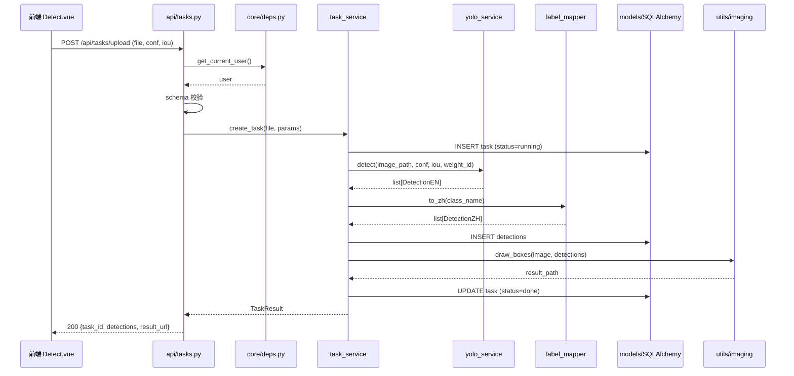
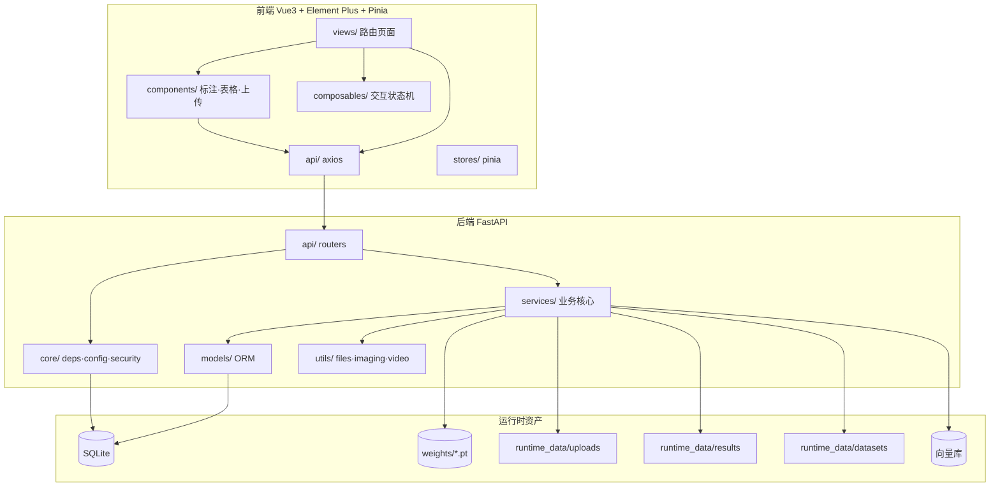

# VisionFlywheel 架构说明

> 版本：v0.1 · 对应 `DESIGN.md` 的技术实施层
>
> 本文回答三个问题：**代码怎么分层**、**目录怎么组织**、**一次请求怎么走完**。

---

## 1. 架构风格

**分层架构（Layered）+ 服务层解耦**。

```
┌─────────────────────────────────────────────┐
│  接入层  api/  FastAPI routers              │  鉴权 · 校验 · 序列化 · 路由
├─────────────────────────────────────────────┤
│  业务层  services/                           │  业务逻辑（不依赖 FastAPI）
├─────────────────────────────────────────────┤
│  数据层  models/ + SQLAlchemy                │  ORM · 事务 · 迁移
├─────────────────────────────────────────────┤
│  横切层  core/ + utils/                      │  配置 · 安全 · 异常 · 工具
└─────────────────────────────────────────────┘
```

**依赖方向（严格单向）**：
```
api  →  services  →  models
 │         │           │
 └──────→ core ←───────┘
```
- `api` 可以调 `services` 和 `core`，不直接操作 `models`
- `services` 可以用 `models` 和 `core`，**不知道 FastAPI 存在**
- `models` 只做 ORM，不调业务
- 反向依赖**一律禁止**（lint 层面可加 import-linter 规则）

**前端同理**：
```
views → components / composables → api/ → 后端
                ↓
              stores (pinia)
```

---

## 2. 为什么这样分

| 决策 | 收益 |
|---|---|
| `services` 不依赖 web 框架 | 可单测；后续可被 CLI、worker、定时任务复用 |
| `schemas` 独立于 `models` | 接口字段变化不污染 ORM；版本演进灵活 |
| 闭环逻辑（检测→校正→导出→训练）全部在 services | 前端只是壳，核心能力可换前端不坏 |
| `core/config` 单一配置源 | DB > env > 默认 三级优先级一处实现 |
| `utils` 只放纯函数 | 文件、图像、视频处理可独立测试 |

---

## 3. 详细目录树

### 3.1 仓库根

```
VisionFlywheel/
├── README.md
├── CHANGELOG.md
├── LICENSE
├── .gitignore
├── .env.example
├── .pre-commit-config.yaml
├── pyproject.toml              # ruff / pyright / pytest 配置（根级）
├── docker-compose.yml
├── docs/
│   ├── DESIGN.md               # 产品设计（已有）
│   ├── ARCHITECTURE.md         # 本文
│   ├── ADR/
│   │   ├── 001-tech-stack.md
│   │   ├── 002-fallback-detector.md
│   │   └── 003-config-priority.md
│   └── API.md                  # OpenAPI 摘要（实施期补）
├── backend/                    # Python 后端
├── frontend/                   # Vue3 前端
├── runtime_data/               # 运行时产物（gitignore）
└── tests/                      # 端到端测试（跨前后端）
```

### 3.2 后端 `backend/`

```
backend/
├── requirements.txt            # 或 pyproject.toml 的 deps（二选一，M1 定）
├── requirements-dev.txt
├── run.py                      # uvicorn entry: python run.py
├── alembic/                    # 数据库迁移（M2 再引入）
│   └── versions/
├── weights/                    # *.pt 权重（gitignore）
│   └── .gitkeep
├── app/
│   ├── __init__.py
│   ├── main.py                 # create_app()，挂载 router、中间件、异常
│   │
│   ├── core/
│   │   ├── __init__.py
│   │   ├── config.py           # Settings (pydantic-settings) + ConfigService
│   │   ├── database.py         # engine / SessionLocal / get_db
│   │   ├── security.py         # 密码哈希、JWT 签发/校验
│   │   ├── deps.py             # get_db / get_current_user / require_admin
│   │   ├── exceptions.py       # AppError + 错误码 + 全局异常处理器
│   │   └── events.py           # 启动/关闭钩子（权重预热、LLM 初始化）
│   │
│   ├── models/                 # SQLAlchemy ORM
│   │   ├── __init__.py
│   │   ├── base.py             # Base / 公共 mixin（id, created_at, updated_at）
│   │   ├── user.py
│   │   ├── weight.py
│   │   ├── task.py
│   │   ├── detection.py
│   │   ├── correction.py
│   │   ├── feedback.py
│   │   ├── config.py
│   │   └── chat.py             # ChatSession / ChatMessage / KnowledgeEntry
│   │
│   ├── schemas/                # Pydantic DTO
│   │   ├── __init__.py
│   │   ├── common.py           # Page, Response, Error
│   │   ├── auth.py
│   │   ├── task.py
│   │   ├── detection.py
│   │   ├── correction.py
│   │   ├── dataset.py
│   │   ├── weight.py
│   │   ├── config.py
│   │   ├── feedback.py
│   │   └── chat.py
│   │
│   ├── api/
│   │   ├── __init__.py
│   │   ├── router.py           # api_router 聚合所有子路由
│   │   ├── auth.py             # /api/auth/*
│   │   ├── tasks.py            # /api/tasks/*
│   │   ├── detections.py       # /api/detections/*
│   │   ├── corrections.py      # /api/corrections/*
│   │   ├── dataset.py          # /api/dataset/*
│   │   ├── weights.py          # /api/weights/*
│   │   ├── train.py            # /api/train/*
│   │   ├── config.py           # /api/config/*
│   │   ├── feedback.py         # /api/feedback/*
│   │   └── chat.py             # /api/chat/*
│   │
│   ├── services/
│   │   ├── __init__.py
│   │   ├── yolo_service.py     # 加载/切换权重、推理、统一检测结构
│   │   ├── fallback_detector.py# torch 不可用时的内置检测器
│   │   ├── label_mapper.py     # 中英映射（读 configs）
│   │   ├── task_service.py     # 任务生命周期（image/batch/video）
│   │   ├── correction_service.py# 校正动作、审计流水
│   │   ├── dataset_exporter.py # 导出 images/labels/data.yaml
│   │   ├── weight_manager.py   # 扫描/切换/热加载
│   │   ├── train_service.py    # 封装 yolo detect train
│   │   ├── config_service.py   # 配置三级优先级 + 变更钩子
│   │   ├── llm_service.py      # LangGraph 链
│   │   ├── rag_service.py      # 向量化、检索、入库
│   │   └── stats_service.py    # 识别/校正统计（供 Chat 用）
│   │
│   └── utils/
│       ├── __init__.py
│       ├── files.py            # 安全文件名、目录、清理
│       ├── imaging.py          # 画框、缩放、可视化
│       ├── video.py            # 抽帧、FPS 采样
│       └── security_utils.py   # 路径穿越防御等
│
└── tests/
    ├── conftest.py             # 测试 DB、client、fixtures
    ├── test_auth.py
    ├── test_yolo_service.py
    ├── test_correction_service.py   # 关键：审计流水
    ├── test_dataset_exporter.py     # 关键：data.yaml 格式
    ├── test_weight_manager.py       # 关键：热切换
    └── test_api_detect.py           # 集成
```

### 3.3 前端 `frontend/`

```
frontend/
├── package.json
├── package-lock.json
├── vite.config.ts
├── tsconfig.json
├── .eslintrc.cjs
├── .prettierrc
├── index.html
├── .env.development            # VITE_API_BASE
├── .env.production
└── src/
    ├── main.ts
    ├── App.vue
    ├── router/
    │   └── index.ts            # 路由 + 守卫（JWT）
    │
    ├── stores/                 # pinia
    │   ├── auth.ts
    │   ├── task.ts             # 当前任务、检测列表
    │   ├── config.ts           # 阈值、默认权重、类别映射
    │   └── notify.ts           # 全局提示
    │
    ├── api/
    │   ├── http.ts             # axios 实例 + 拦截器（注入 token、错误统一）
    │   ├── auth.ts
    │   ├── tasks.ts
    │   ├── detections.ts
    │   ├── corrections.ts
    │   ├── dataset.ts
    │   ├── weights.ts
    │   ├── train.ts
    │   ├── config.ts
    │   ├── feedback.ts
    │   └── chat.ts
    │
    ├── types/
    │   └── index.ts            # 与后端 schema 对应的 TS 类型
    │
    ├── views/                  # 路由页面
    │   ├── Login.vue
    │   ├── Dashboard.vue
    │   ├── Detect.vue          # 上传 + 识别 + 结果
    │   ├── Annotate.vue        # 校正工作台（核心）
    │   ├── Dataset.vue         # 数据集管理
    │   ├── Weights.vue         # 权重管理
    │   ├── Train.vue           # 训练任务
    │   ├── Chat.vue            # 智能分析
    │   └── Admin.vue           # 用户 / 工单 / 审计 / 配置
    │
    ├── components/
    │   ├── ImageAnnotator.vue  # ★ Canvas 标注核心（画框/拖拽/补框）
    │   ├── DetectionTable.vue
    │   ├── UploadDrop.vue      # 拖拽上传（单图/批量/视频）
    │   ├── ConfigPanel.vue     # 阈值、权重切换
    │   ├── FeedbackDialog.vue
    │   ├── StatsCard.vue
    │   └── ChatWindow.vue
    │
    ├── composables/
    │   ├── useAnnotator.ts     # 标注交互状态机
    │   ├── useTask.ts
    │   └── useWebSocket.ts     # 批量识别进度（M6）
    │
    └── styles/
        └── tokens.scss         # 色板、字号、间距
```

---

## 4. 请求生命周期（以"识别一张图"为例）



---

## 5. 配置中心

**优先级**：`数据库 configs 表 > 环境变量 > 代码默认值`

**实现要点**：
- `core/config.py` 的 `Settings` 用 pydantic-settings 读 env + 默认值
- `services/config_service.py` 提供 `get(key)`：先查 DB，未命中回落到 Settings
- 变更后触发钩子：`on_change("default_weight_id") → weight_manager.reload()`
- 变更后触发钩子：`on_change("llm_model") → llm_service.reset()`

**关键配置项**：
| key | 默认 | 说明 |
|---|---|---|
| `default_weight_id` | null | 当前使用的权重 |
| `conf_threshold` | 0.5 | 默认置信度 |
| `iou_threshold` | 0.45 | 默认 IoU |
| `label_map` | `{dog: 狗, ...}` | 中英映射 |
| `val_ratio` | 0.2 | 导出训练集 val 比例 |
| `llm_model` | `Qwen/Qwen2.5-0.5B-Instruct` | 本地对话模型 |
| `enable_fallback_detector` | true | torch 不可用时降级 |

---

## 6. 数据库与状态

- **起步**：SQLite（`runtime_data/app.db`），SQLAlchemy ORM
- **迁移**：M2 引入 Alembic（避免 M1 阻塞）
- **资产**：
  - `runtime_data/uploads/` 原始上传（按 task_id 分子目录）
  - `runtime_data/results/` 可视化结果
  - `runtime_data/datasets/dataset_{ts}/` 导出的训练集
  - `backend/weights/*.pt` 模型权重
- **资产版本化**（M4 起）：每次导出/训练记录 `dataset_version` / `weight_version`，存 `corrections`/`weights` 表

---

## 7. 测试策略落点

| 关键能力 | 测试文件 | 断言 |
|---|---|---|
| 校正流水写入 | `test_correction_service.py` | 每个动作产生一条 `corrections`，`detections.status` 正确 |
| 训练集导出 | `test_dataset_exporter.py` | `data.yaml` 可被 ultralytics 解析；train/val 划分正确；labels 是归一化坐标 |
| 权重热切换 | `test_weight_manager.py` | 切换默认权重后，下一次推理使用新权重；不重启服务 |
| 鉴权 | `test_auth.py` | 无 token 401、过期 token 401、越权 403 |
| 检测主链 | `test_api_detect.py` | 上传→返回 detections；中文标签正确 |
| 降级路径 | `test_fallback_detector.py` | torch 不可用时闭环仍返回合法 detections |

**不做**（0-to-1 阶段）：UI 自动化、性能压测、安全渗透。M6 再补 e2e。

---

## 8. 模块边界速查

| 想做 | 去哪改 |
|---|---|
| 加一种校正动作 | `services/correction_service.py` + `models/correction.py` + 前端 `ImageAnnotator.vue` |
| 改导出格式 | `services/dataset_exporter.py` |
| 换检测器 | 实现 `services/detector.py` 协议，`yolo_service` / `fallback_detector` 各给一个实现 |
| 加一个配置项 | `services/config_service.py` 默认值 + 前端 `ConfigPanel.vue` |
| 加一个 API | `api/xxx.py` + `schemas/xxx.py` + 前端 `api/xxx.ts` |
| 加一种智能意图 | `services/llm_service.py` 的 LangGraph 节点 |

---

## 9. 架构图（合并视图）


