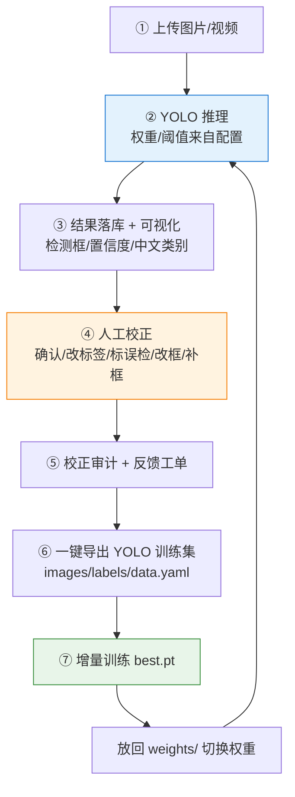
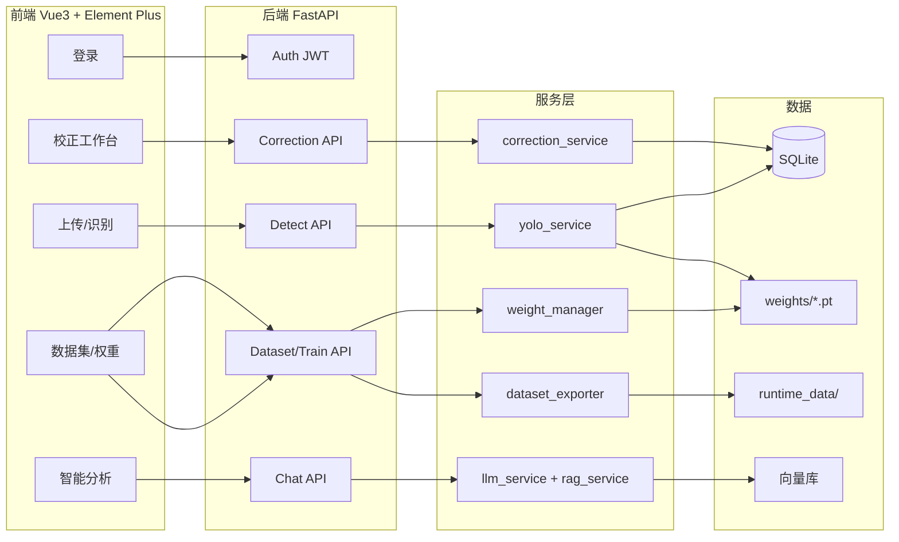

# 视觉飞轮 VisionFlywheel — 设计文档

> 以 YOLO 为核心、人工校正为飞轮动力的自进化图像识别闭环系统。
>
> 版本：v0.1（规划稿） · 日期：2026-11-07

---

## 1. 系统定位

**一句话**：上传即识别 → 识别即可视化 → 看得不对就在图上改 → 改完的数据自动变训练集 → 训练回流后模型更强。

**核心理念**：YOLO 给出的不是终点，而是一段可以被修正、被回流、被训练的起点。每一次人工校正都是给飞轮加一把力。

**目标场景**：工业质检、仓储分拣、果蔬/零件盘点、巡检取证、现场照片数字化。

---

## 2. 核心闭环



**关键点**：
- ④ 人工校正是整个飞轮的动力源（数据质量 > 模型结构）
- ⑦ 回流到 ② 形成闭环，模型随业务一起成长
- 中间的 ⑤ 审计与工单，保证每一次校正可追溯

---

## 3. 技术栈

| 层 | 选型 | 说明 |
|---|---|---|
| 目标检测 | YOLO（ultralytics） | 默认 `yolov8n.pt`，可切换 `yolo26n.pt` 等 |
| 后端 | FastAPI + SQLAlchemy + JWT | 异步 API，SQLite 起步（可平移到 PostgreSQL） |
| 前端 | Vue3 + Element Plus + Vite | SPA，含 Canvas 标注交互 |
| 智能体 | LangChain + LangGraph | 意图分类 → 检索 → 生成 → 反思 |
| 检索增强 | RAG + 向量库 | 默认离线哈希向量兜底，可插 Chroma/FAISS |
| 部署 | Docker Compose | backend + frontend 一键起 |
| 训练 | ultralytics CLI | 封装为后端任务，输出 `best.pt` |

---

## 4. 目录结构

```
VisionFlywheel/
├── README.md
├── docker-compose.yml
├── docs/
│   ├── DESIGN.md              # 本文档
│   └── API.md                 # 接口文档（实施期补）
├── backend/
│   ├── requirements.txt
│   ├── run.py
│   ├── app/
│   │   ├── main.py            # FastAPI 入口
│   │   ├── core/              # config / security / database / deps
│   │   ├── api/               # 路由：auth / detect / correct / dataset / weight / admin / chat
│   │   ├── models/            # SQLAlchemy ORM
│   │   ├── schemas/           # Pydantic DTO
│   │   ├── services/          # yolo / correction / dataset_exporter / weight_manager / llm / rag
│   │   └── utils/             # label_mapper（中英映射）/ video / files
│   └── weights/               # *.pt 权重目录（运行时可热切换）
├── frontend/
│   ├── package.json
│   ├── vite.config.ts
│   └── src/
│       ├── views/             # Login / Dashboard / Detect / Annotate / Dataset / Weight / Admin / Chat
│       ├── components/        # ImageAnnotator（核心）/ DetectionTable / ConfigPanel / UploadDrop
│       ├── stores/            # pinia: auth / task / config
│       └── api/               # axios 封装
└── runtime_data/
    ├── uploads/               # 原图/视频
    ├── results/               # 可视化结果图
    └── datasets/              # 导出的 YOLO 训练集
```

---

## 5. 数据模型（SQLAlchemy）

| 表 | 关键字段 | 说明 |
|---|---|---|
| `users` | id, username, password_hash, role(admin/user) | JWT 认证 |
| `weights` | id, filename, path, is_default, uploaded_at, source(manual/trained) | 权重注册表 |
| `tasks` | id, type(image/batch/video), status, created_by, created_at | 识别任务 |
| `detections` | id, task_id, image_path, class_id, class_name, confidence, x1,y1,x2,y2, status(pending/corrected/rejected) | 检测结果 |
| `corrections` | id, detection_id, action(confirm/relabel/false_positive/adjust/add), old_value, new_value, operator, created_at | 校正流水审计 |
| `feedback_tickets` | id, detection_id, user_id, content, status(open/resolved), reply | 反馈工单（用户→管理员） |
| `configs` | key, value, source(db/env/default) | 系统配置（阈值、默认权重、映射表） |
| `chat_sessions` / `chat_messages` | id, session_id, role, content, created_at | 智能问答 |
| `knowledge_entries` | id, question, answer, source, embedding, created_at | RAG 知识库 |

---

## 6. 模块划分

### 6.1 后端服务层

| 模块 | 职责 |
|---|---|
| `yolo_service` | 加载/切换权重，执行推理，输出统一检测结构；依赖不可用时降级为内置检测器 |
| `correction_service` | 接收校正动作、写 `corrections` 审计、更新 `detections.status` |
| `dataset_exporter` | 把校正后的样本导出为标准 `dataset_xxx/{images,labels,data.yaml}`，支持 train/val 划分 |
| `weight_manager` | 扫描 `weights/`、切换默认权重、热加载（不重启服务） |
| `llm_service` | LangGraph 链：意图分类 → 检索 → 读取统计上下文 → 生成 → 反思自检 |
| `rag_service` | 向量化、相似检索、"存入知识库" 写入 |

### 6.2 前端页面

| 页面 | 核心能力 |
|---|---|
| 登录 | JWT |
| 控制台 | 任务概览、统计卡片 |
| 上传/识别 | 单图、批量、视频抽帧；阈值可调 |
| **校正工作台** | Canvas 画框：确认 / 改标签 / 标误检 / 拖拽改框 / 拖拽补框 |
| 数据集管理 | 筛选未导出样本 → 一键导出 → 下载 |
| 权重管理 | 上传 `.pt`、切换默认、查看训练产物 |
| 智能分析 | 对话式解读识别结果，支持存入知识库 |
| 后台管理 | 用户、反馈工单、审计流水、系统配置 |

---

## 7. 关键设计决策

1. **配置优先级**：`数据库 > 环境变量 > 代码默认值`。页面改配置 → 写库 → 缓存刷新 → 服务层热更新（权重/LLM/Embedding 同步重建）。
2. **降级策略**：优先 `ultralytics` 真实推理；torch 不可用 / 无 GPU 时按配置降级为内置检测器（例如基于颜色/轮廓的占位实现），**闭环依旧完整可跑**，页面给出明确提示。先跑通流程，再补环境。
3. **中英标签映射**：推理输出英文 `dog` → 映射表 → 前端显示「狗」。映射表存 `configs`，可编辑。
4. **训练集格式**：严格遵循 ultralytics 标准（`images/{train,val}`、`labels/{train,val}`、`data.yaml`），保证导出即可训。
5. **训练回流**：封装 `yolo detect train` 为后端任务；训练完成产物 `best.pt` 落到 `weights/`，页面切换默认权重即生效，**无需改代码、无需重启**。
6. **校正不可变**：`corrections` 只追加不修改，形成完整审计链路。
7. **角色权限**：普通用户做校正/反馈/提问；管理员做导出/训练/切权重/处理工单/改配置。

---

## 8. API 概要

```
POST   /api/auth/login
GET    /api/tasks / POST /api/tasks/upload  (image | batch | video)
GET    /api/tasks/{id}/detections
POST   /api/detections/{id}/correct
POST   /api/feedback
GET    /api/dataset/pending                 # 未导出样本
POST   /api/dataset/export
GET    /api/weights  / POST /api/weights/upload
PUT    /api/weights/{id}/default            # 切换默认权重
POST   /api/train                           # 触发增量训练
GET    /api/config  / PUT /api/config
POST   /api/chat                            # 智能分析
POST   /api/chat/knowledge                  # 存入知识库
```

---

## 9. 里程碑与实施顺序

| 里程碑 | 内容 | 验收 |
|---|---|---|
| **M1 骨架** | 后端 FastAPI + SQLite + JWT；前端 Vue3 + Element Plus 跑通登录；配置中心雏形 | 登录、访问受保护接口 |
| **M2 识别主链** | 单图上传 → YOLO 推理 → 落库 → 结果图 + 明细表；中英映射 | 上传一张图能看到检测框 |
| **M3 校正闭环** | Canvas 校正（五种动作）→ 审计流水 → 反馈工单 | 在图上改完能查到审计记录 |
| **M4 导出与回流** | 数据集导出（data.yaml + train/val）→ 训练任务 → 权重热切换 | 端到端闭环走通一轮 |
| **M5 智能分析** | LangGraph 链 + RAG 知识库 + 反思节点 | 问答基于真实识别统计 |
| **M6 加固交付** | 批量/视频、降级路径、Docker Compose、README | 一条命令起全套 |

**建议实施顺序**：M1 → M2 → M3 → M4 先把**视觉飞轮的闭环转起来**，M5/M6 再补智能与交付形态。

---

## 10. 风险与待定

| 风险 | 应对 |
|---|---|
| 无 GPU / torch 安装失败 | M2 即内置降级检测器，保证流程可演示 |
| YOLO26 权重获取 | 起步用 `yolov8n.pt`，两者 API 兼容 |
| 视频抽帧性能 | M6 再做，先抽关键帧（FPS 可配） |
| 向量库离线 | 默认哈希向量兜底，可后换 Chroma/FAISS |
| 中文类别覆盖 | 映射表可配置，随业务扩展 |

**待定**（可先跑起来再决定）：
- 训练集 train/val 划分比例（默认 8:2）
- 反馈工单是否需要邮件/IM 通知
- 多人协作时的校正冲突策略（当前版本先单管理员模式）

---

## 附录：系统总体架构图


